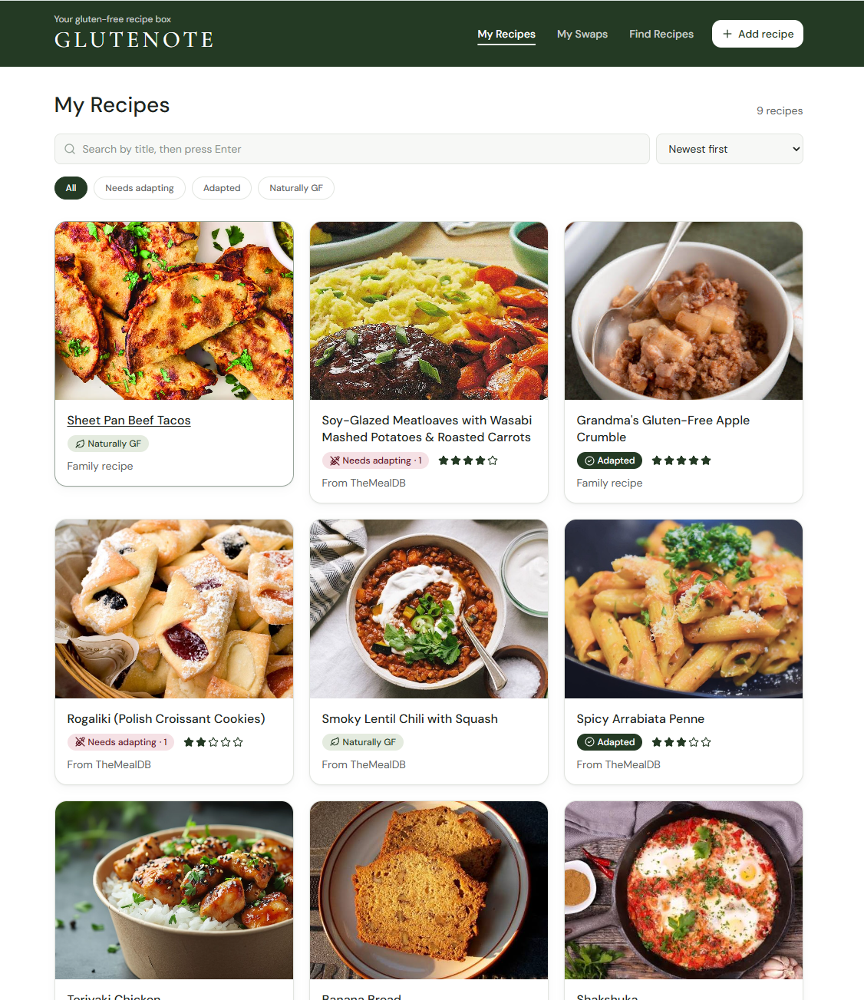
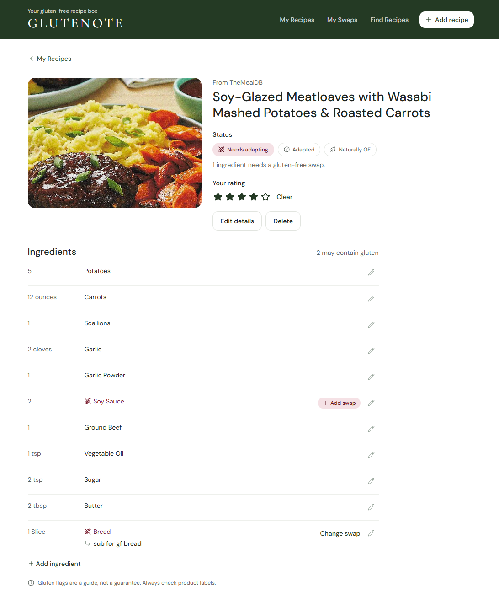
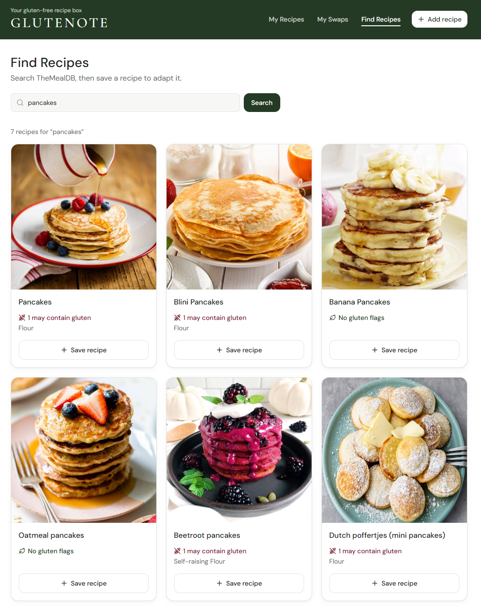

# Glutenote

**Remember every swap that worked.**

Glutenote is a gluten-free recipe box. Save family recipes or find new ones on TheMealDB, see which ingredients may contain gluten, and record the gluten-free swaps that worked, so you never have to figure out the same recipe twice.

Built with React, Flask, and PostgreSQL for the Flatiron School Software Engineering Capstone (Project 1).



## Features

- **My Recipes:** every saved recipe as a card, with a status badge and star rating, plus:
  - **Search** by title, **sort** (newest, oldest, A–Z, highest rated), and **filter** by status
  - **Pagination** (12 recipes per page), with the page, search, and filters kept in the URL
- **Three gluten-free statuses:** *Needs adapting* (with a count of swaps still needed), *Adapted*, and *Naturally GF*
- **Gluten flagging:** ingredients that may contain gluten are flagged automatically, using a keyword check with known gluten-free exceptions (e.g., rice flour and tamari are not flagged)
- **Swaps:** record a gluten-free substitute for any flagged ingredient with **Add swap** or **Change swap**. When every flagged ingredient has a swap, Glutenote offers to mark the recipe as adapted
- **Suggested swaps:** when adding a swap, Glutenote suggests substitutes you've used before for similar ingredients (e.g., your "all-purpose flour" swap is suggested for "plain flour")
- **My Swaps:** a page listing every swap you've recorded, most used first, with links to the recipes that used it
- **Ratings:** rate each recipe from 1 to 5 stars
- **Notes:** keep your own notes on each recipe ("used 1:1 GF flour, came out great")
- **Find Recipes:** search TheMealDB, preview which ingredients would be flagged, and save a recipe to start adapting it
- **Add and edit family recipes**, including ingredients, instructions, and a photo link

> Gluten flagging is a keyword check, not a guarantee. Always check product labels.

## Screenshots

| Recipe detail | Find Recipes |
|---|---|
|  |  |

## Tech Stack

- **Frontend:** React (Vite), React Router, Tailwind CSS, Lucide icons
- **Backend:** Flask, Flask-SQLAlchemy, Flask-Migrate, Flask-CORS
- **Database:** PostgreSQL
- **External API:** [TheMealDB](https://www.themealdb.com/api.php) (free, no key needed)
- **Testing:** pytest

## Installation

You'll need Python 3.12, Node.js, and PostgreSQL.

### 1. Clone the repo

```bash
git clone https://github.com/hanjennings1/glutenote.git
cd glutenote
```

### 2. Set up the backend

```bash
cd backend
python -m venv venv
source venv/bin/activate
pip install -r requirements.txt
```

Create a PostgreSQL database named `glutenote_dev`:

```bash
createdb glutenote_dev
```

Copy the environment template, then open `.env` and fill in your PostgreSQL username and password:

```bash
cp .env.example .env
```

Create the tables and add the sample recipes:

```bash
flask --app app db upgrade
python seed.py
```

Start the API (it runs at http://localhost:5555):

```bash
python app.py
```

### 3. Set up the frontend

In a second terminal, from the `glutenote` folder:

```bash
cd frontend
npm install
npm run dev
```

Open http://localhost:5173 in your browser.

## Usage

1. **Find a recipe:** go to **Find Recipes**, search for a dish (e.g., "lasagne"), and click **Save recipe**.
2. **Adapt it:** on the recipe page, flagged ingredients are marked with a wheat icon. Click **Add swap** to record a gluten-free substitute. If you've swapped a similar ingredient before, pick it from the **Used before** suggestions.
3. **Mark it adapted:** once every flagged ingredient has a swap, click **Mark as adapted**.
4. **Rate it:** after you've made it, give the recipe 1 to 5 stars on its page.
5. **Find it again:** on **My Recipes**, search by title, filter by status, or sort by **Highest rated**.
6. **Review your swaps:** open **My Swaps** to see every substitute you've recorded and where you used it.
7. **Add a family recipe:** click **Add recipe**, fill in the basics, then add ingredients on the next page.

## API

All responses are JSON. Errors always use the shape `{"error": "message"}`.

| Method | Route | Description |
|---|---|---|
| GET | `/recipes` | List recipes, one page at a time, with optional search, filter, and sort (see below) |
| GET | `/recipes/<id>` | One recipe, with its ingredients |
| POST | `/recipes` | Create a recipe (optionally with ingredients) |
| PATCH | `/recipes/<id>` | Update a recipe's title, instructions, photo, status, notes, or rating |
| DELETE | `/recipes/<id>` | Delete a recipe and its ingredients |
| POST | `/ingredients` | Add an ingredient to a recipe (needs `recipe_id`) |
| PATCH | `/ingredients/<id>` | Update an ingredient, e.g., record a gluten-free swap |
| DELETE | `/ingredients/<id>` | Delete an ingredient |
| GET | `/swaps` | Every recorded swap, grouped, most used first. Optional `?ingredient=` returns suggestions for one ingredient |
| GET | `/search?q=` | Search TheMealDB. Returns previews with gluten flags (nothing is saved) |
| POST | `/recipes/import` | Save a TheMealDB recipe by `mealdb_id`, with gluten flagged |

**Status codes:** 200 OK, 201 created, 204 deleted, 400 invalid input, 404 not found, 409 recipe already saved, 502 TheMealDB unavailable.

### GET /recipes options

| Parameter | Values | Default |
|---|---|---|
| `status` | `needs_adapting`, `adapted`, `naturally_gf` | all |
| `q` | text to search for in recipe titles (case-insensitive) | none |
| `sort` | `newest`, `oldest`, `title`, `rating` (highest first, unrated last) | `newest` |
| `page` | page number, starting at 1 | `1` |
| `per_page` | recipes per page, 1–50 | `12` |

Example: `GET /recipes?q=bread&sort=rating&page=1`

```json
{
  "recipes": [ { "id": 2, "title": "Banana Bread", "gf_status": "adapted", "rating": 4, "swaps_needed": 0, ... } ],
  "page": 1,
  "per_page": 12,
  "total": 1,
  "pages": 1
}
```

### Examples

Record a swap:

```http
PATCH /ingredients/14
Content-Type: application/json

{ "gf_substitute": "1:1 gluten-free flour blend" }
```

Rate a recipe (use `null` to clear the rating):

```http
PATCH /recipes/2
Content-Type: application/json

{ "rating": 4 }
```

Get swap suggestions for an ingredient:

```http
GET /swaps?ingredient=plain flour
```

```json
[
  {
    "ingredient": "all-purpose flour",
    "substitute": "1:1 gluten-free flour blend",
    "times_used": 2,
    "recipes": [ { "id": 2, "title": "Banana Bread" }, { "id": 4, "title": "Apple Crumble" } ]
  }
]
```

## Running Tests
The backend has 68 tests covering gluten flagging, TheMealDB parsing, every API route, search, sort, and pagination, ratings, and swap suggestions. The tests use a temporary in-memory database and a fake TheMealDB, so they don't need PostgreSQL or an internet connection, and they never touch your saved recipes.

```bash
cd backend
source venv/bin/activate
pytest
```

## Project Structure

```
├── frontend/                      React + Vite frontend
│   ├── index.html                 Page shell, title, fonts
│   ├── package.json               Frontend dependencies and scripts
│   ├── vite.config.js             Vite + Tailwind CSS setup
│   ├── public/
│   │   └── favicon.svg            Glutenote browser-tab icon
│   └── src/
│       ├── main.jsx               Starts React with the router
│       ├── App.jsx                NavBar and page routes
│       ├── api.js                 apiFetch helper for calling Flask
│       ├── index.css              Tailwind theme: colors, fonts, radius
│       ├── statuses.js            The 3 gluten-free statuses and labels
│       ├── ui.js                  Shared button and input styles
│       ├── components/            NavBar, RecipeCard, StatusBadge, StatusPicker, StarRating,
│       │                          IngredientList, IngredientItem, AddIngredientForm,
│       │                          SwapSuggestions, NotesEditor, SearchResult,
│       │                          LoadingSpinner, ErrorMessage
│       └── pages/
│           ├── RecipeList.jsx     My Recipes: search, sort, filter, and pages
│           ├── RecipeDetail.jsx   One recipe: ingredients, swaps, status, rating, notes
│           ├── RecipeForm.jsx     Add or edit a recipe
│           ├── SwapsPage.jsx      My Swaps: every recorded swap
│           ├── SearchPage.jsx     Find Recipes (TheMealDB search)
│           └── NotFound.jsx       404 page
├── backend/                       Flask API
│   ├── app.py                     API routes
│   ├── config.py                  App, database, and CORS setup
│   ├── models.py                  Recipe and Ingredient models
│   ├── gluten.py                  Flags ingredients that may contain gluten
│   ├── mealdb.py                  TheMealDB search and lookup
│   ├── seed.py                    Adds sample recipes
│   ├── migrations/                Database migrations (Flask-Migrate)
│   ├── tests/                     pytest tests (68)
│   ├── pytest.ini                 pytest settings
│   ├── requirements.txt           Python dependencies
│   └── .env.example               Template for environment variables
├── screenshots/                   Images for this README
└── README.md
```

## Assumptions

- **Single-user by design.** Glutenote has no login, so everyone using an installation shares one recipe box. Per the course overview, authentication is reserved for Project 2.
- **Gluten flags are a guide.** Flagging uses keyword matching, so users can turn any flag on or off and should always check product labels.

## Future Improvements
- Rate how well each individual swap worked, not just the whole recipe
- A fourth status, *Proven*, for adapted recipes you've made and loved
- A shopping list for a recipe that uses your gluten-free swaps
- A printable recipe card showing the adapted version
- Tags such as "weeknight" and a cook log of each time a recipe is made
- Deploy the app so it can be tried without installing it

## Acknowledgments

Recipe data and photos from [TheMealDB](https://www.themealdb.com/).